  <h1 align="center">Hi there, I'm Angkon Nath 👋</h1>

  

  

    📍 Based in <b>Dhaka, Bangladesh</b> | 🚀 Building software solutions & startups
  

  

    
    
  

---

### 👨‍💻 About Me

- 💼 **Co-founder & CEO** at [Bohuvuj.com](https://bohuvuj.com)
- 🔭 Working on scalable web applications, mobile platforms, and AI-driven products.
- 💡 Passionate about Flutter mobile development, fullstack engineering, and applied computer vision / ML.
- 🌱 Continuously exploring modern AI tooling, cloud systems, and scalable product architectures.
- 💬 Ask me about **Flutter, Python, JavaScript/TypeScript, Fullstack Web Dev, or Startup Building**.
- 📫 Reach me on GitHub: [@angkon101](https://github.com/angkon101)

---

### 🎯 3D Space Shooter // Tech Skill Battle Arena

  

 

  
<b>🛠️ Full Tech Stack Arsenal & Skill Tree (Click to Expand / Collapse)</b>

   

  #### **Languages**
  

    
    
    
    
    
    
    
  

  #### **Frameworks & Libraries**
  

    
    
    
    
    
    
    
  

  #### **Tools & Platforms**
  

    
    
    
    
    
  

---

### 🎮 Mario Contribution Adventure

  

---

### 📊 3D Interactive Analytics Console

  

 

  
<b>⚡ Live GitHub Activity & Streak Metrics (Click to Expand / Collapse)</b>

   
  

    
    
  

  

    
  

  
<b>🍩 Interactive Language Donut Breakdown (Click to Expand)</b>

   
  

    
  

---

### 🌟 Featured Repositories

| Project | Description | Tech Stack |
|:---|:---|:---|
| 🏢 **[khujepai.bohuvuj](https://github.com/angkon101/khujepai.bohuvuj)** | Bohuvuj ecosystem application | Web / Fullstack |
| 🤖 **[ai-companion](https://github.com/angkon101/ai-companion)** | Intelligent interactive AI assistant companion | JavaScript / Node / AI |
| 🧠 **[Early-Brain-Tumor-Detection](https://github.com/angkon101/Early-Brain-Tumor-Detection)** | Deep learning medical image classification model | Python / ML / Deep Learning |
| 📱 **[demo_currency_app](https://github.com/angkon101/demo_currency_app)** | Cross-platform mobile currency exchange converter | Flutter / Dart |
| 🍽️ **[Restaurant-POS](https://github.com/angkon101/Restaurant-POS)** | Point-of-Sale management system for restaurants | Fullstack Web |

---

### 🌐 Connect & Collaborate

  
  
  

---

  ⭐️ Profile designed for <b>@angkon101</b> | Thanks for visiting!

